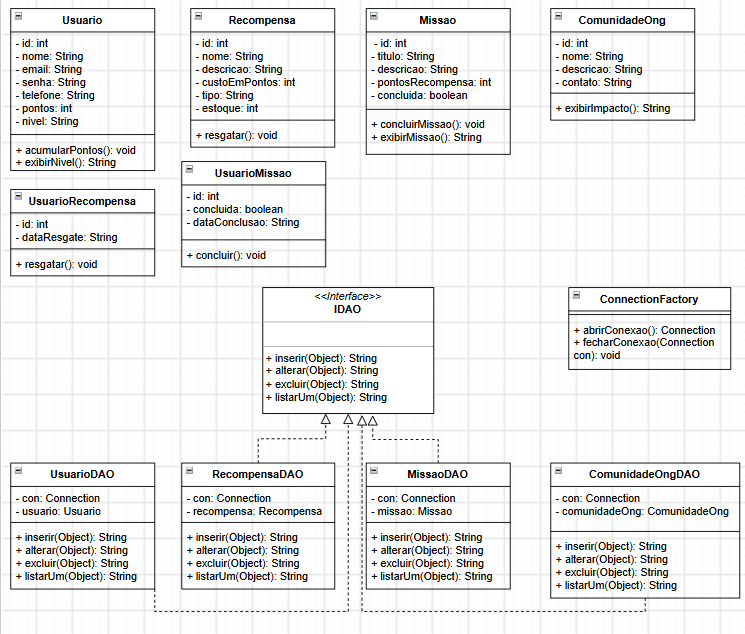

# SoulPet — Sistema Java (Camada de Domínio e Persistência)

Projeto acadêmico desenvolvido para a FIAP (Domain Driven Design Using Java), como parte da entrega individual da 3ª sprint do projeto **SoulPet** — plataforma de gamificação para engajamento de tutores de pets em causas de proteção animal, integrando missões sustentáveis, pontuação, loja solidária e doações a ONGs parceiras.

Este repositório contém a camada Java do sistema: modelagem de domínio, persistência em banco de dados Oracle via JDBC, e uma classe de teste para simular o uso da aplicação.

## Sobre o projeto

O SoulPet é uma iniciativa da InovaLab para a plataforma SoulUp (Challenge FIAP), na qual usuários completam missões relacionadas ao bem-estar animal (curtir/compartilhar campanhas de adoção, engajar com a comunidade), acumulam pontos por gamificação, e trocam esses pontos por produtos na loja solidária ou doam para ONGs parceiras cadastradas.

## Tecnologias

- Java 21
- JDBC (driver `ojdbc17`)
- Oracle Database
- IntelliJ IDEA

## Arquitetura

O projeto segue uma estrutura em camadas, sem controller nem view — a interação com o usuário é simulada via `JOptionPane` na própria classe de teste:

```
src/
└── br/com/fiap/
    ├── dto/      → classes de domínio (atributos, construtores, getters/setters e métodos de lógica de negócio)
    ├── dao/      → interface IDAO, DAOs concretas e ConnectionFactory
    ├── main/     → classe de teste (simula o uso da aplicação)
    └── imagens/  → diagrama de classes UML
lib/              → driver JDBC (ojdbc17.jar)
```

### Camada `dto`
Entidades do domínio: `Usuario`, `Missao`, `Recompensa`, `ComunidadeOng`, `UsuarioMissao`, `UsuarioRecompensa`.

Cada entidade concentra suas próprias regras de negócio, por exemplo:
- `Usuario.acumularPontos()` — credita pontos ao usuário
- `Missao.concluirMissao()` — marca uma missão como concluída
- `Recompensa.resgatar()` — valida e decrementa o estoque de um produto
- `UsuarioRecompensa.resgatar()` / `UsuarioMissao.concluir()` — registram a data do evento por usuário

### Camada `dao`
- `IDAO` — interface genérica com os métodos `inserir(Object)`, `alterar(Object)`, `excluir(Object)` e `listarUm(Object)`, todos retornando `String`
- `UsuarioDAO`, `MissaoDAO`, `RecompensaDAO`, `ComunidadeOngDAO` — implementações concretas de `IDAO`, cada uma com CRUD completo para sua entidade
- `ConnectionFactory` — responsável por abrir e fechar a conexão com o banco Oracle

### Camada `main`
Classe de teste com menu interativo (`JOptionPane`), que instancia objetos e simula a utilização da aplicação, exercitando as operações de CRUD de cada entidade através das DAOs.

## Diagrama de Classes (UML)

O diagrama abaixo representa as classes de domínio (`dto`), a interface `IDAO`, as DAOs concretas e a `ConnectionFactory`.



## Como executar

**Pré-requisitos:**
- Java JDK 21 instalado
- IntelliJ IDEA (ou outra IDE compatível com projetos Java)
- Driver JDBC `ojdbc17.jar` adicionado às dependências do projeto
- Acesso a um banco Oracle configurado (os dados de conexão — usuário e senha — estão definidos em `ConnectionFactory`)

**Passo a passo:**
1. Clone o repositório:
```
   git clone https://github.com/biancapereirasilva/projeto-soulpet-java-dao-dto.git
```
2. Abra o projeto no IntelliJ IDEA
3. O driver `ojdbc17.jar` já está na pasta `lib/`. Adicione-o às bibliotecas do projeto (Project Structure → Libraries → + → Java → selecione `lib/ojdbc17.jar`)
4. Verifique/atualize os dados de conexão em `ConnectionFactory`, caso necessário
5. Execute a classe `Main` (pacote `br.com.fiap.main`)
6. Use o menu interativo para testar as operações de inserir, alterar, excluir e consultar cada entidade

## Autoria

Desenvolvido por Bianca Pereira Silva — FIAP, curso de Análise e Desenvolvimento de Sistemas (turma 1TDSR-2026), como parte do projeto SoulPet (Challenge FIAP / InovaLab).